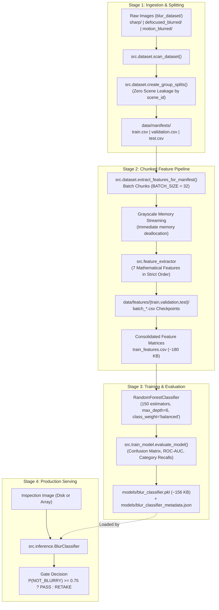

# Standalone Lightweight Image Blur Classifier for SealScan

[](https://www.python.org/downloads/)
[](https://opensource.org/licenses/MIT)
[]()
[]()

A high-performance, RAM-safe, and CPU-efficient binary sharpness classifier designed as an upstream quality gate for **SealScan** (an AI-assisted Legal Metrology inspection system).

The model evaluates camera focus quality, identifying blurred photos before downstream inspection workflows (such as seal OCR, tampering risk analysis, or dimensional verification) are executed.

---

## Table of Contents
1. [Overview & Scope Boundary](#1-overview--scope-boundary)
2. [Project Architecture](#2-project-architecture)
   - [System Architecture & Data Flow](#21-system-architecture--data-flow)
   - [Directory Structure](#22-directory-structure)
   - [Core Components Breakdown](#23-core-components-breakdown)
3. [Memory Management & Architectural Principles](#3-memory-management--architectural-principles)
4. [Low-Level Sharpness Features](#4-low-level-sharpness-features)
5. [Dataset & Split Strategy](#5-dataset--split-strategy)
6. [Benchmark & Evaluation Metrics](#6-benchmark--evaluation-metrics)
7. [Quickstart & Usage](#7-quickstart--usage)
8. [SealScan Production Integration Guide](#8-sealscan-production-integration-guide)
9. [Repository & Git Architecture](#9-repository--git-architecture)

---

## 1. Overview & Scope Boundary

In automated image inspection, blurry captures degrade downstream neural network accuracy and cause verification errors. This classifier functions as an immediate, low-latency filter:

```text
[Camera Capture] --> [Blur Classifier Gate] --+--> [PASS]   --> [Downstream SealScan Workflows]
                                              +--> [RETAKE] --> [User Alert: "Image blurry, retake"]
```

> **Strict Scope Boundary:**
> - **Binary Classification Only:** Predicts image sharpness (`BLURRY` vs `NOT_BLURRY`) with calibrated probability scores.
> - **No Object / Seal Detection:** Does not detect or localize seals, barcodes, text, or instruments.
> - **Pure CPU-Based Pipeline:** Zero PyTorch, TensorFlow, CUDA, or GPU dependencies; built exclusively with OpenCV, NumPy, scikit-image, and scikit-learn.
> - **RAM-Safe Streaming:** Engineered for memory-constrained environments (peak training RAM < 70 MB).

---

## 2. Project Architecture

### 2.1 System Architecture & Data Flow

The project is structured into four decoupled stages:



### 2.2 Directory Structure

The repository maintains an explicit directory layout where data and model directories are preserved via `.gitkeep` placeholders while keeping multi-gigabyte datasets out of version control:

```text
blur_image_detector/
├── .gitignore                      # Git rules excluding datasets, tracking architecture
├── README.md                       # Comprehensive system documentation
├── requirements.txt                # Lightweight CPU-only dependencies
├── train_model.py                  # Root CLI entry point for full pipeline execution
├── inference_example.py            # Standalone inference demonstration script
├── image_sample.png                # Sample image for immediate inference testing
│
├── src/                            # Core Python package
│   ├── __init__.py                 # Package initialization & exports
│   ├── config.py                   # Centralized configuration, hyperparams, & paths
│   ├── feature_extractor.py        # 7-feature mathematical extraction engine
│   ├── dataset.py                  # Data ingestion, group splitting, chunked extraction
│   ├── train_model.py              # Model training, validation, and evaluation pipeline
│   └── inference.py                # Standalone low-latency inference class (BlurClassifier)
│
├── blur_dataset/                   # Raw Kwentar Blur Dataset (excluded from Git)
│   ├── sharp/                      # Sharp in-focus images (.gitkeep tracked)
│   ├── defocused_blurred/          # Defocus blurred images (.gitkeep tracked)
│   └── motion_blurred/             # Motion blurred images (.gitkeep tracked)
│
├── data/                           # Processed data artifacts (excluded from Git)
│   ├── manifests/                  # Zero-leakage metadata splits (.gitkeep tracked)
│   │   ├── train.csv
│   │   ├── validation.csv
│   │   └── test.csv
│   └── features/                   # Checkpointed feature extraction CSVs (.gitkeep tracked)
│       ├── train/                  # batch_0000.csv ... batch_0022.csv
│       ├── validation/             # batch_0000.csv ... batch_0004.csv
│       ├── test/                   # batch_0000.csv ... batch_0005.csv
│       ├── train_features.csv
│       ├── validation_features.csv
│       └── test_features.csv
│
├── logs/                           # Runtime diagnostics & failed image logs
│   ├── .gitkeep                    # Preserved directory placeholder
│   └── failed_images.txt           # Extraction error logs (if any)
│
└── models/                         # Trained model artifacts
    ├── .gitkeep                    # Preserved directory placeholder
    ├── blur_classifier.pkl         # Lightweight production bundle (~156 KB)
    └── blur_classifier_metadata.json # Full hyperparameter & evaluation record
```

### 2.3 Core Components Breakdown

| Component | File | Responsibilities |
|:---|:---|:---|
| **Configuration** | `src/config.py` | Constants, feature ordering, batch size (`32`), worker threads (`4`), hyperparameters, class mappings (`0: BLURRY`, `1: NOT_BLURRY`). |
| **Feature Extractor** | `src/feature_extractor.py` | Standalone mathematical transforms using OpenCV, NumPy, and scikit-image. Extracts 7 ordered features with single-image RAM release. |
| **Dataset Pipeline** | `src/dataset.py` | Metadata-only directory scanner, scene-based deterministic split (zero leakage), multi-threaded chunked batch extraction with resume capabilities. |
| **Training Pipeline** | `src/train_model.py` | Trains `RandomForestClassifier` on compact tabular data (~180 KB), provides out-of-core `SGDClassifier` fallback, computes comprehensive metrics, and exports bundles. |
| **Inference Engine** | `src/inference.py` | Production-ready `BlurClassifier` wrapper accepting disk paths or NumPy arrays (`predict_from_path`, `predict_from_array`). |

---

## 3. Memory Management & Architectural Principles

1. **Grayscale-Only Streaming (Zero Whole-Dataset Ingestion):**
   - Images are loaded strictly one at a time via `cv2.imread(path, cv2.IMREAD_GRAYSCALE)`.
   - Feature arrays are computed and memory is immediately reclaimed (`del gray`) before processing the next image.
   - Peak RAM during feature extraction: **69.3 MB**.

2. **Chunked Checkpoint / Resume Pattern:**
   - Features are computed in batches of 32 images and flushed to `data/features/{split}/batch_XXXX.csv`.
   - If interrupted, re-running the script resumes from the latest batch without re-extracting completed images.

3. **Zero Scene Leakage by Design:**
   - Multi-frame datasets contain identical physical scenes captured under different blur conditions (e.g., `0_IPHONE-SE_S.JPG`, `0_IPHONE-SE_F.JPG`, `0_IPHONE-SE_M.JPG`).
   - The splitter isolates the `scene_id` (`0_IPHONE-SE`) and ensures all variations of a scene reside strictly in one split (Train 70%, Validation 15%, Test 15%). The pipeline strictly asserts zero scene ID overlap.

4. **Microscopic Deployment Footprint:**
   - The production artifact `models/blur_classifier.pkl` is **~156 KB**.
   - Requires zero neural network runtimes (no ONNX runtime, no PyTorch, no TensorFlow).

---

## 4. Low-Level Sharpness Features

The model extracts 7 frequency-domain and spatial-domain features in strict order:

| Index | Feature Name | Method & Implementation | Importance | Description |
|:---:|:---|:---|:---:|:---|
| 0 | `laplacian_variance` | `cv2.Laplacian(gray, cv2.CV_64F).var()` | 5.11% | High-pass focus score measuring second derivative intensity variance. |
| 1 | `edge_strength` | `cv2.Sobel(..., 1, 0)` & `cv2.Sobel(..., 0, 1)` | 7.61% | Mean magnitude of first-order gradient vectors $\sqrt{g_x^2 + g_y^2}$. |
| 2 | `noise` | `gray - cv2.GaussianBlur(gray, (3, 3), 0)` | 5.04% | Standard deviation of residual high-frequency sensor noise. |
| 3 | `brenner_sharpness` | $\frac{1}{N} \sum (I[x+2, y] - I[x, y])^2$ | 12.68% | Horizontal second-difference focus metric. |
| 4 | `canny_edge_density` | `cv2.Canny(gray, 100, 200).mean() / 255` | 26.04% | Proportion of detected structural edge pixels. |
| 5 | `fft_high_frequency_ratio` | 2D FFT spectral energy ratio | **39.05%** | Ratio of high-frequency power outside 512×512 center mask to total energy. |
| 6 | `blur_effect` | `skimage.measure.blur_effect(gray)` | 4.47% | Edge-spread reblur metric quantifying edge dispersion. |

---

## 5. Dataset & Split Strategy

The classifier is trained and evaluated on the **[Blur Dataset by Kwentar (Kaggle)](https://www.kaggle.com/datasets/kwentar/blur-dataset)**, containing 350 distinct real-world scenes across 1,050 high-resolution camera captures:

- **Source & Attribution:** [Kaggle - Blur Dataset by Kwentar](https://www.kaggle.com/datasets/kwentar/blur-dataset)
- **Sub-Categories:**
  - `sharp`: 350 images (Ground truth label `1` / `NOT_BLURRY`)
  - `defocused_blurred`: 350 images (Ground truth label `0` / `BLURRY`)
  - `motion_blurred`: 350 images (Ground truth label `0` / `BLURRY`)
- **Group-Based Split Breakdown:**
  - **Train (70%):** 732 images (244 scenes)
  - **Validation (15%):** 156 images (52 scenes)
  - **Test (15%):** 162 images (54 scenes)

### Dataset Setup Instructions (For Training)
To retrain or benchmark the model from scratch:
1. Download the dataset archive from [Kaggle: Blur Dataset](https://www.kaggle.com/datasets/kwentar/blur-dataset).
2. Extract the archive into the `blur_dataset/` directory so that each category folder contains the raw `.JPG` images:
   ```text
   blur_dataset/
   ├── sharp/                 # Place sharp images here
   ├── defocused_blurred/     # Place defocused images here
   └── motion_blurred/        # Place motion blurred images here
   ```
*(Note: If you only need to run inference, downloading the raw dataset is not required. The pre-trained model bundle `models/blur_classifier.pkl` is already included and self-contained.)*

---

## 6. Benchmark & Evaluation Metrics

Evaluated on the independent test split (162 unseen images, 54 unseen scenes):

### Quantitative Performance
| Metric | Score | Note |
|:---|:---:|:---|
| **Accuracy** | **96.91%** | 157 / 162 test images classified correctly |
| **ROC-AUC** | **99.37%** | Near-perfect separation between sharp and blurry distributions |
| **Precision (Sharp)** | **92.98%** | Very low false-positive rate |
| **Recall (Sharp)** | **98.15%** | 53 / 54 sharp images correctly accepted |
| **Defocus Blur Recall** | **100.0%** | 54 / 54 defocus blurred images detected |
| **Motion Blur Recall** | **92.59%** | 50 / 54 motion blurred images detected |
| **F1 Score** | **95.50%** | Harmonic mean of precision and recall |

### Test Confusion Matrix
| | Predicted BLURRY | Predicted NOT_BLURRY |
|:---|:---:|:---:|
| **Actual BLURRY** (108) | **104** (True Negative) | 4 (False Positive) |
| **Actual NOT_BLURRY** (54) | 1 (False Negative) | **53** (True Positive) |

---

## 7. Quickstart & Usage

### 7.1 Installation

Clone the repository and install dependencies:
```bash
git clone <repository-url>
cd blur_image_detector
pip install -r requirements.txt
```

### 7.2 Dataset Setup (Only Required for Re-Training)

If you plan to retrain the model, download the [Blur Dataset from Kaggle](https://www.kaggle.com/datasets/kwentar/blur-dataset) and extract it into `blur_dataset/`:
```text
blur_dataset/sharp/*.JPG
blur_dataset/defocused_blurred/*.JPG
blur_dataset/motion_blurred/*.JPG
```

### 7.3 Training the Model

To run data scanning, group splitting, chunked feature extraction, and model training:
```bash
python train_model.py
```
This generates:
1. `data/manifests/{train,validation,test}.csv`
2. `data/features/{train,validation,test}/*.csv`
3. `models/blur_classifier.pkl`
4. `models/blur_classifier_metadata.json`

### 7.4 Standalone Inference Example

Run inference on any image using the pre-packaged script (no dataset download required):
```bash
python inference_example.py image_sample.png
```
Example Output:
```text
Evaluating Image: image_sample.png
--------------------------------------------------
Result:
  Prediction:              BLURRY
  Probability (BLURRY):     0.7744
  Probability (NOT_BLURRY): 0.2256

Extracted Feature Metrics:
  - laplacian_variance        : 105.810721
  - edge_strength             : 14.244564
  - noise                     : 2.154562
  - brenner_sharpness         : 56.257225
  - canny_edge_density        : 0.005376
  - fft_high_frequency_ratio  : 0.650641
  - blur_effect               : 0.509088
--------------------------------------------------
```

---

## 8. SealScan Production Integration Guide

In production, SealScan only requires `models/blur_classifier.pkl` and `src/inference.py` (or `src/feature_extractor.py`).

### Option A: Using the `BlurClassifier` Class (Recommended)

```python
from src.inference import BlurClassifier

# Initialize classifier once (loads the 156 KB bundle)
classifier = BlurClassifier(model_path="models/blur_classifier.pkl")

# Predict directly from file path (releases image memory immediately)
result = classifier.predict_from_path("inspection_photo.jpg")

print(f"Prediction: {result['prediction']}")
print(f"Sharpness Probability: {result['probability_not_blurry']:.2%}")
print(f"Blur Probability:      {result['probability_blurry']:.2%}")

# SealScan Decision Rule
SEALSCAN_THRESHOLD = 0.75
if result["probability_not_blurry"] >= SEALSCAN_THRESHOLD:
    print("PASS: Forwarding to SealScan inspection pipeline.")
else:
    print("RETAKE: Image too blurry for reliable legal metrology verification.")
```

### Option B: Direct Array Evaluation (In-Memory Pre-Loaded Frame)

```python
import cv2
from src.inference import BlurClassifier

classifier = BlurClassifier()
frame = cv2.imread("frame.jpg")

result = classifier.predict_from_array(frame)
if result["probability_not_blurry"] >= 0.75:
    process_frame(frame)
```

### Option C: Self-Contained Bundle Loading (Zero `src` Dependency)

```python
import joblib
import pandas as pd
from src.feature_extractor import extract_features_from_path

# Load bundle
bundle = joblib.load("models/blur_classifier.pkl")
model = bundle["model"]
feature_names = bundle["feature_names"]

# Extract 7 features
features = extract_features_from_path("photo.jpg")
X = pd.DataFrame([features], columns=feature_names)

# Get probabilities: [P(BLURRY), P(NOT_BLURRY)]
probs = model.predict_proba(X)[0]
is_sharp = probs[1] >= 0.75
```

---

## 9. Repository & Git Architecture

To maintain a clean version history while enabling reproduction from scratch:
- **Datasets Excluded:** High-resolution image files in `blur_dataset/` and large archives (`*.zip`, `*.tar.gz`) are strictly ignored via `.gitignore`. The dataset can be downloaded separately from the [Kaggle Blur Dataset](https://www.kaggle.com/datasets/kwentar/blur-dataset).
- **Generated Features Excluded:** Intermediate batch extractions in `data/features/` and local manifests in `data/manifests/` are excluded to prevent machine-specific absolute path leakage.
- **Architecture Preserved:** All required folders contain `.gitkeep` files, ensuring that cloning the repository provides the exact directory skeleton needed to drop in raw datasets and run `python train_model.py`.
- **Portable Model Bundled:** The lightweight production model `models/blur_classifier.pkl` (~156 KB) and metadata JSON are tracked in Git, enabling instant out-of-the-box inference without retraining.
Blur Image classifier